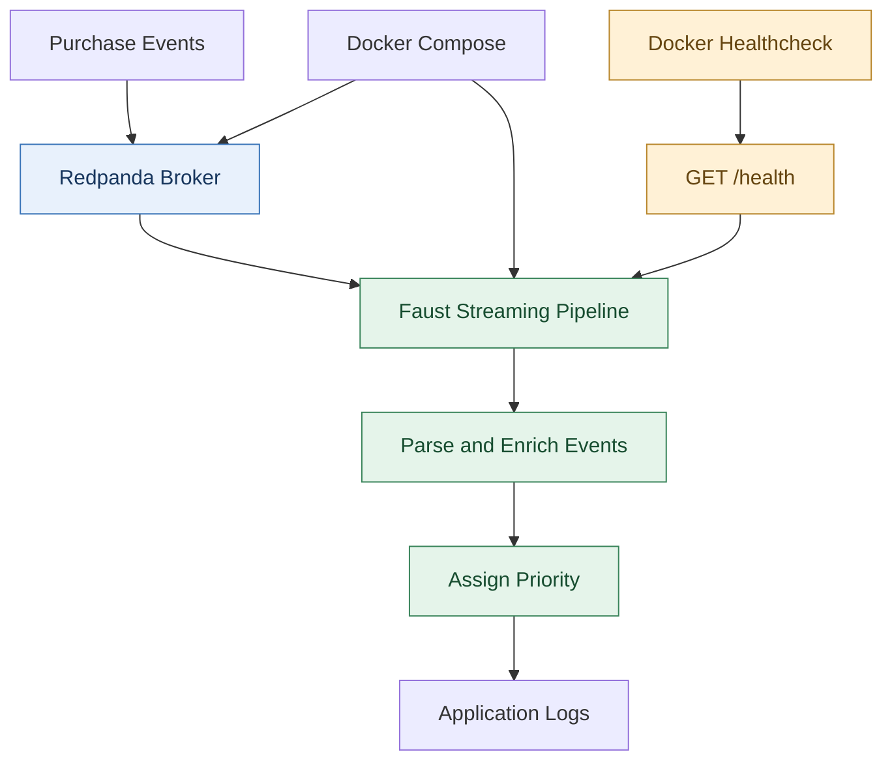

# Lab — Deploying a Containerized Streaming Pipeline with Docker Compose

**Difficulty:** Intermediate  


## Introduction

A data engineering team operates a streaming pipeline that processes purchase events through a Kafka-compatible message broker. Although the pipeline works in development, deploying it consistently requires managing dependencies, service startup, and application health. The team decides to containerize the Faust streaming application, configure a healthcheck endpoint, and use Docker Compose to manage the broker and pipeline together. This lab builds a repeatable deployment that can be started, monitored, and restarted with minimal manual intervention.

### Project File Structure

Create the following project structure:

```text
datahive-pipeline/
├── src/
│   ├── __init__.py
│   └── streaming.py
├── scripts/
│   └── publish_test_event.sh
├── Dockerfile
├── compose.yaml
├── requirements.txt
├── .dockerignore
├── .gitattributes
└── README.md
```

> **Note on `src/__init__.py`:** This file marks the `src/` directory as a standard Python package. Without it, the Faust CLI worker (`faust -A src.streaming worker`) can fail with `ModuleNotFoundError: No module named 'src'`.

### Architecture Diagram



---

## Chapter 1 — Verify Docker

Open your terminal and verify that the Docker Engine and Docker Compose are installed and the Docker daemon is running:

```bash
docker --version
docker compose version
docker info
```

The commands verify that the Docker CLI and Compose plugin are installed and that the background daemon responds. If you encounter permission errors on Linux, ensure your user is added to the `docker` group (`sudo usermod -aG docker $USER`). On Windows, verify that Docker Desktop is running and configured for Linux containers (WSL 2 backend).

---

## Chapter 2 — Prepare the Application Dependencies

Create or edit `requirements.txt` in the `datahive-pipeline/` root:

```text
faust-streaming==0.11.3
aiohttp==3.9.5
```

Save the file.

> **Dependency Compatibility Note:** We pin `aiohttp==3.9.5`. Faust-streaming `0.11.3` relies on `aiohttp-cors`, which is compatible with `aiohttp < 3.10`. Using newer releases such as `aiohttp >= 3.11` causes internal routing conflicts at startup.

---

## Chapter 3 — Implement the Streaming Pipeline

Create `src/__init__.py`:

```python
# Marks src as a Python package
```

Open `src/streaming.py` and implement the Faust streaming agent and broker-aware healthcheck endpoint:

```python
import json
import logging
import os

import faust

logging.basicConfig(level=logging.INFO)
logger = logging.getLogger(__name__)

BROKER_URL = os.getenv(
    "KAFKA_BROKER_URL",
    "kafka://redpanda:9092",
)

app = faust.App(
    "datahive-pipeline",
    broker=BROKER_URL,
    web_port=6066,
)

events_topic = app.topic(
    "datahive-events",
    value_type=bytes,
    value_serializer="raw",
)


@app.agent(events_topic)
async def process_events(events):
    async for raw_event in events:
        try:
            event = json.loads(raw_event.decode("utf-8"))
            event_type = event.get("event_type", "activity")
            amount = float(event.get("amount", 0))

            if event_type == "purchase" and amount > 500:
                priority = "critical"
            elif event_type == "purchase":
                priority = "high"
            else:
                priority = "normal"

            result = {
                **event,
                "source": "datahive",
                "processed": True,
                "priority": priority,
            }

            logger.info("Processed event: %s", result)

        except (ValueError, TypeError, UnicodeDecodeError) as exc:
            logger.warning("Invalid event: %s", exc)


@app.page("/health")
async def healthcheck(self, request):
    """
    HTTP Healthcheck Endpoint.
    Returns HTTP 200 when the Kafka transport is connected.
    Returns HTTP 503 during broker discovery or disconnection.
    """
    transport_connected = (
        app.consumer is not None
        and not getattr(app.consumer, "_closed", True)
    )
    if transport_connected:
        return self.json(
            {"status": "healthy", "service": "datahive-pipeline"},
            status=200,
        )
    return self.json(
        {"status": "starting", "service": "datahive-pipeline"},
        status=503,
    )
```

Save the file.

> **Key Architectural Notes:**
> 1. **Native Faust Web Routing:** Faust uses `@app.page("/health")` to register web routes. Direct calls to `app.web.router.add_get` fail because `app.web` is a Faust service driver, not a raw aiohttp router.
> 2. **Transport-Aware Healthcheck:** The `/health` endpoint checks `app.consumer` connection status. If the broker is unreachable, it returns HTTP 503, preventing false-positive healthy statuses.
> 3. **Raw Byte Serialization:** `value_serializer="raw"` ensures clean handling of incoming byte payloads produced by external tools like `rpk`.

---

## Chapter 4 — Create the Dockerfile

Create `Dockerfile` in the `datahive-pipeline/` root:

```dockerfile
FROM python:3.11-slim

ENV PYTHONDONTWRITEBYTECODE=1 \
    PYTHONUNBUFFERED=1 \
    PYTHONPATH=/app

WORKDIR /app

RUN apt-get update \
    && apt-get install -y --no-install-recommends curl \
    && rm -rf /var/lib/apt/lists/*

COPY requirements.txt .

RUN pip install --no-cache-dir -r requirements.txt

COPY src/ ./src/

RUN useradd --create-home --uid 10001 appuser \
    && chown -R appuser:appuser /app

USER appuser

EXPOSE 6066

CMD ["faust", "-A", "src.streaming", "worker", "-l", "info"]
```

Save the file.

> **Key Settings:**
> - `PYTHONPATH=/app`: Ensures module resolution works reliably for `src.streaming` under non-root users.
> - `curl`: Installed specifically for Docker container health checks.
> - `USER appuser`: Runs as an unprivileged user (UID 10001) following security best practices.

---

## Chapter 5 — Configure Docker Compose

Create `compose.yaml` in the `datahive-pipeline/` root:

```yaml
networks:
  datahive:
    driver: bridge

services:
  redpanda:
    image: redpandadata/redpanda:v24.2.18
    command:
      - redpanda
      - start
      - --mode
      - dev-container
      - --smp
      - "1"
      - --memory
      - "1G"
      - --overprovisioned
      - --node-id
      - "0"
      - --kafka-addr
      - internal://0.0.0.0:9092
      - --advertise-kafka-addr
      - internal://redpanda:9092
    ports:
      - "19092:9092"
    networks:
      - datahive
    healthcheck:
      test: ["CMD-SHELL", "rpk cluster health | grep -q 'Healthy:.*true'"]
      interval: 10s
      timeout: 5s
      retries: 10
      start_period: 20s
    restart: unless-stopped
    deploy:
      resources:
        limits:
          memory: 1.5G

  pipeline:
    build:
      context: .
      dockerfile: Dockerfile
    environment:
      KAFKA_BROKER_URL: kafka://redpanda:9092
    ports:
      - "6066:6066"
    networks:
      - datahive
    depends_on:
      redpanda:
        condition: service_healthy
    healthcheck:
      test:
        - CMD
        - curl
        - -fsS
        - http://127.0.0.1:6066/health
      interval: 15s
      timeout: 5s
      retries: 5
      start_period: 60s
    restart: unless-stopped
    deploy:
      resources:
        limits:
          memory: 512M
```

Save the file.

> **Key Settings:**
> - `CMD-SHELL` with `grep`: Avoids false negatives from Redpanda exit code 10 during initial Raft election.
> - `start_period: 60s` & `retries: 5`: Allows adequate buffer time during cold boot and broker negotiation.
> - Named Network `datahive`: Isolates the services and provides predictable DNS resolution.
> - Memory Limits: Prevents runaway memory consumption on shared developer machines.

---

## Chapter 6 — Exclude Unnecessary Files and Set Line Endings

Create `.dockerignore` in the project root:

```text
.git/
.venv/
__pycache__/
*.py[cod]
.env
.env.*
output/
data/
```

Create `.gitattributes` in the project root to guarantee Unix line endings for shell scripts:

```text
*.sh text eol=lf
```

Save both files.

---

## Chapter 7 — Build and Start the Services

From the `datahive-pipeline/` directory, validate and start the deployment:

```bash
# 1. Validate Compose configuration syntax
docker compose config

# 2. Build the Faust application container image
docker compose build

# 3. Start services in the background
docker compose up -d

# 4. Check container status
docker compose ps
```

> **Startup Timing Tip:** Allow 30–60 seconds for Redpanda to elect its Raft leader and for Faust to join the consumer group. If you check logs immediately with `docker compose logs pipeline`, you may see temporary connection retry notices while Redpanda completes startup. Wait until `docker compose ps` shows `(healthy)`:

```bash
# To check health status on any Docker version:
docker inspect $(docker compose ps -q pipeline) --format '{{.State.Health.Status}}'
```

---

## Chapter 8 — Verify the Healthcheck

Once the services report `healthy`, verify the HTTP endpoint:

```bash
curl -i http://localhost:6066/health
```

Expected HTTP response:

```http
HTTP/1.1 200 OK
Content-Type: application/json; charset=utf-8
Content-Length: 49

{"status":"healthy","service":"datahive-pipeline"}
```

> If you receive HTTP `503 Service Unavailable`, Faust is still negotiating its partition assignment with Redpanda. Wait 10 seconds and query again.

---

## Chapter 9 — Publish a Test Event

Create `scripts/publish_test_event.sh`:

```bash
#!/usr/bin/env bash
set -euo pipefail

docker compose exec -T redpanda \
  rpk topic create datahive-events \
  --if-not-exists

printf '%s\n' \
  '{"event_id":"evt-1001","event_type":"purchase","user_id":"user_101","amount":750}' \
  | docker compose exec -T redpanda \
      rpk topic produce datahive-events
```

Save the file.

### Running the Test Event

**Linux / macOS / WSL 2:**
```bash
chmod +x scripts/publish_test_event.sh
./scripts/publish_test_event.sh
```

**Windows (PowerShell / CMD):**
```bash
bash scripts/publish_test_event.sh
```

### Inspect the Processed Event Logs

```bash
docker compose logs --tail=50 pipeline
```

Look for the enriched JSON output showing `critical` priority:

```text
[INFO] Processed event: {'event_id': 'evt-1001', 'event_type': 'purchase', 'user_id': 'user_101', 'amount': 750.0, 'source': 'datahive', 'processed': True, 'priority': 'critical'}
```

---

## Chapter 10 — Stop and Restart the Deployment

Stop the deployment:

```bash
docker compose down
```

Restart the deployment:

```bash
docker compose up -d
```

Verify service status:

```bash
docker compose ps
```

> **Storage Notice:** In this lab configuration, Redpanda runs in ephemeral mode without persistent volume bindings. Stopping the stack with `docker compose down` will discard topics and offsets. For persistent deployments, mount a named volume to `/var/lib/redpanda/data`.

---

## Conclusion

The Faust streaming pipeline is now cleanly containerized and managed alongside the Redpanda message broker via Docker Compose. The implementation features:
- A non-root security context.
- A broker-aware HTTP `/health` endpoint checked by Docker.
- Proper service startup sequencing (`depends_on: { condition: service_healthy }`).
- Robust stream processing with automatic event priority assignment.
