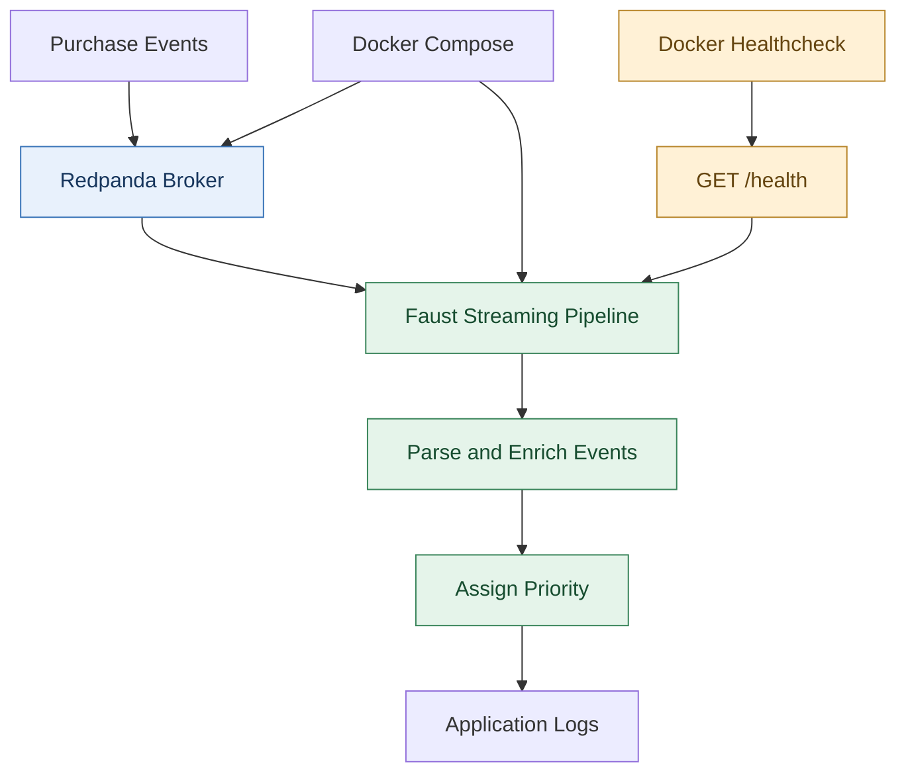

# Lab 4.5 — Pipeline Dockerization

**Difficulty:** Intermediate  
**Type:** Standalone  
**Status:** Pending

## Introduction

A data engineering team operates a streaming pipeline that processes purchase events through a Kafka-compatible message broker. Although the pipeline works in development, deploying it consistently requires managing dependencies, service startup, and application health. The team decides to containerize the Faust streaming application, configure a healthcheck endpoint, and use Docker Compose to manage the broker and pipeline together. This lab builds a repeatable deployment that can be started, monitored, and restarted with minimal manual intervention.

### Project File Structure

Create the following project structure in VS Code Server.

```text
datahive-pipeline/
├── src/
│   ├── __init__.py
│   └── streaming.py
├── scripts/
│   └── publish_test_event.sh
├── Dockerfile
├── compose.yaml
├── requirements.txt
├── .dockerignore
└── README.md
```


### Architecture Diagram



## Chapter 1 — Verify Docker

Open the VS Code Server terminal and check whether Docker is installed and the daemon is accessible.

```bash
docker --version
docker info
docker compose version
```


The commands verify that Docker Engine and Docker Compose are available. The `docker info` command also checks whether the Docker daemon is responding. Resolve any Docker service or permission errors before continuing.

## Chapter 2 — Prepare the Application Dependencies

Open `requirements.txt` in VS Code Server and add:

```text
faust-streaming==0.11.3
aiohttp==3.11.18
```

Save the file.


The dependency file defines the Python packages required by the application. Docker installs these dependencies while building the image, keeping the runtime environment consistent across machines. The HTTP library is used to implement the healthcheck endpoint.

## Chapter 3 — Implement the Streaming Pipeline

Open `src/streaming.py` and add the following code:

```python
import json
import logging
import os

import faust
from aiohttp import web

logging.basicConfig(level=logging.INFO)
logger = logging.getLogger(__name__)

BROKER_URL = os.getenv(
    "KAFKA_BROKER_URL",
    "kafka://redpanda:9092",
)

app = faust.App(
    "datahive-pipeline",
    broker=BROKER_URL,
    web_port=6066,
)

events_topic = app.topic(
    "datahive-events",
    value_type=bytes,
)


@app.agent(events_topic)
async def process_events(events):
    async for raw_event in events:
        try:
            event = json.loads(raw_event.decode("utf-8"))
            event_type = event.get("event_type", "activity")
            amount = float(event.get("amount", 0))

            if event_type == "purchase" and amount > 500:
                priority = "critical"
            elif event_type == "purchase":
                priority = "high"
            else:
                priority = "normal"

            result = {
                **event,
                "source": "datahive",
                "processed": True,
                "priority": priority,
            }

            logger.info("Processed event: %s", result)

        except (ValueError, TypeError, UnicodeDecodeError) as exc:
            logger.warning("Invalid event: %s", exc)


async def healthcheck(request):
    return web.json_response({
        "status": "healthy",
        "service": "datahive-pipeline",
    })


app.web.router.add_get("/health", healthcheck)
```

Save the file.


The Faust agent consumes messages from the `datahive-events` topic and enriches each valid event with a source, processing status, and priority. Purchases above 500 receive the `critical` priority, while other purchases receive `high`. The `/health` endpoint returns a JSON response that can be checked by Docker.

## Chapter 4 — Create the Dockerfile

Create `Dockerfile` in the project root.

```dockerfile
FROM python:3.11-slim

ENV PYTHONDONTWRITEBYTECODE=1 \
    PYTHONUNBUFFERED=1

WORKDIR /app

RUN apt-get update \
    && apt-get install -y --no-install-recommends curl \
    && rm -rf /var/lib/apt/lists/*

COPY requirements.txt .

RUN pip install --no-cache-dir -r requirements.txt

COPY src/ ./src/

RUN useradd --create-home --uid 10001 appuser \
    && chown -R appuser:appuser /app

USER appuser

EXPOSE 6066

CMD ["faust", "-A", "src.streaming", "worker", "-l", "info"]
```

Save the file.


The Dockerfile packages the source code and dependencies into a reusable image. The application runs as a non-root user to reduce unnecessary privileges. Port `6066` is reserved for the health endpoint, which will be checked through Docker Compose.

## Chapter 5 — Configure Docker Compose

Create `compose.yaml` in the project root.

```yaml
services:
  redpanda:
    image: redpandadata/redpanda:v24.2.18
    command:
      - redpanda
      - start
      - --mode
      - dev-container
      - --smp
      - "1"
      - --memory
      - "1G"
      - --overprovisioned
      - --node-id
      - "0"
      - --kafka-addr
      - internal://0.0.0.0:9092
      - --advertise-kafka-addr
      - internal://redpanda:9092
    ports:
      - "19092:9092"
    healthcheck:
      test: ["CMD", "rpk", "cluster", "health"]
      interval: 10s
      timeout: 5s
      retries: 10
      start_period: 20s

  pipeline:
    build:
      context: .
      dockerfile: Dockerfile
    environment:
      KAFKA_BROKER_URL: kafka://redpanda:9092
    ports:
      - "6066:6066"
    depends_on:
      redpanda:
        condition: service_healthy
    healthcheck:
      test:
        - CMD
        - curl
        - -fsS
        - http://127.0.0.1:6066/health
      interval: 15s
      timeout: 5s
      retries: 3
      start_period: 40s
    restart: unless-stopped
```

Save the file.


Docker Compose defines both services and their startup relationship. The pipeline waits until the broker reports healthy before starting, and Docker periodically checks the application's HTTP endpoint. The Redpanda configuration is intended for a local development lab rather than a production cluster.

## Chapter 6 — Exclude Unnecessary Files

Create `.dockerignore` in the project root.

```text
.git/
.venv/
__pycache__/
*.py[cod]
.env
.env.*
output/
data/
```

Save the file.


The `.dockerignore` file prevents unnecessary files from entering the Docker build context. Excluding environment files reduces the risk of accidentally copying credentials into the image. Secrets should still be managed through a dedicated secrets-management mechanism when deploying to production.

## Chapter 7 — Build and Start the Services

Run these commands from the project root in the VS Code Server terminal.

Validate the configuration:

```bash
docker compose config
```

Build the application image:

```bash
docker compose build
```

Start both services:

```bash
docker compose up -d
```

Inspect their status:

```bash
docker compose ps
```


The build command creates the pipeline image, while `docker compose up -d` starts the broker and application in the background. The status command displays the current state and health of the services. If a service fails to start, inspect its logs before proceeding.

```bash
docker compose logs --tail=100 redpanda
docker compose logs --tail=100 pipeline
```

## Chapter 8 — Verify the Healthcheck

Check the service status:

```bash
docker compose ps
```

Send a request to the application endpoint:

```bash
curl -i http://localhost:6066/health
```

Expected response:

```json
{
  "status": "healthy",
  "service": "datahive-pipeline"
}
```


A successful response confirms that the endpoint is reachable and responding as expected. Docker uses the same endpoint to update the pipeline container's health status. This check measures HTTP responsiveness and does not guarantee that the broker connection or event-processing logic is working correctly.

## Chapter 9 — Publish a Test Event

Open `scripts/publish_test_event.sh` and add:

```bash
#!/usr/bin/env bash
set -euo pipefail

docker compose exec -T redpanda \
  rpk topic create datahive-events \
  --if-not-exists

printf '%s\n' \
  '{"event_id":"evt-1001","event_type":"purchase","user_id":"user_101","amount":750}' \
  | docker compose exec -T redpanda \
      rpk topic produce datahive-events
```

Save the file and make it executable:

```bash
chmod +x scripts/publish_test_event.sh
```

Publish the event:

```bash
./scripts/publish_test_event.sh
```

Inspect the application logs:

```bash
docker compose logs --tail=50 pipeline
```


The test event contains a purchase amount of 750, so the pipeline should assign it the `critical` priority. The logs should show the enriched event with `source` set to `datahive` and `processed` set to `true`. This test verifies the message-processing path in addition to the health endpoint.

## Chapter 10 — Stop and Restart the Deployment

Stop the services:

```bash
docker compose down
```

Start them again:

```bash
docker compose up -d
```

Check the status:

```bash
docker compose ps
```


Docker Compose provides a consistent way to manage the lifecycle of the broker and pipeline. The containers can be recreated using the same configuration without manually reinstalling application dependencies. No persistent broker volume is configured in this lab, so broker data should be treated as disposable.

## Conclusion

The streaming pipeline is now packaged into a Docker image and managed alongside its message broker through Docker Compose. The healthcheck endpoint provides a simple way to monitor application responsiveness, while the test event verifies that the Faust agent can process incoming purchase data. The deployment can be started, inspected, stopped, and restarted using repeatable commands. These practices provide a foundation for more reliable containerized streaming deployments.


